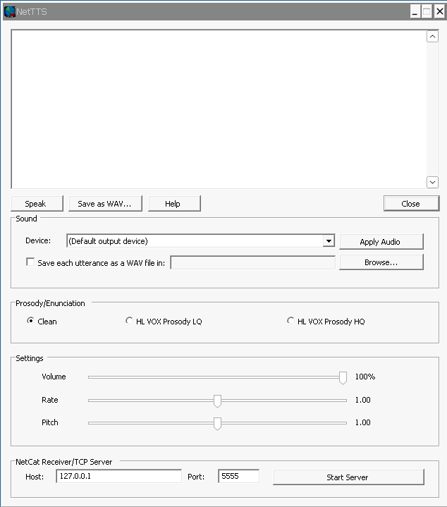

# NetTTS

<p align="center">
  
</p>

<p align="center">
  
</p>

<p align="center">
  <strong>Demo video (YouTube)</strong><br />
  <a href="https://www.youtube.com/watch?v=PFJt_EG5f_c">
    
  </a>
</p>


NetTTS is a small Win32 GUI that wraps FlexTalk and other SAPI 4.0 voices. It’s meant to run on old Windows boxes, modern Windows, or Wine.

## Project Strengths

- Works on retro Windows installs without a hunt for old DLLs.
- Builds cleanly on Linux with MinGW-w64.
- Bundles a known-good `speech.h` so headers don’t drift.
- Matches the maintainer’s Devuan + Wine workflow.
- Preserves the legacy of AT&T's Flextalk Engine in a public repository.
- Preserves the legacy of Valve's game "Halflife" as this Engine was used for the "VOX"/Black Mesa Announcement System samples in the game.
- Implements a unique prosody encoder system based on observations of the utility of valve's fictionally created VOX announcement system
- Fun! :D

## Run the prebuilt binary

1. Download the zip from [Releases](../../releases) and unpack it.
2. Install the SAPI 4.0 runtime (`third_party/Dependencies/spchapi.exe`) if needed.
3. Install FlexTalk from `third_party/Dependencies/flextalk.zip`.
4. Launch `nettts_gui.exe` on Windows or via Wine (`wrun ./build/nettts_gui.exe`).

Want to make it sing? There’s a [NetTTS sing-along gist](https://gist.github.com/h4rm0n1c/2ddaa14c03be25c2072347a1b27e25da).

## Wine prefix automation

If you want a ready-to-roll Wine XP sandbox with SAPI 4.0, FlexTalk, and NetTTS preinstalled, run:

```bash
./scripts/winetricks/setup_nettts_prefix.sh
```

Or pull the latest helper directly from GitHub:

```bash
curl -fsSLo setup_nettts_prefix.sh https://raw.githubusercontent.com/h4rm0n1c/NetTTS/main/scripts/winetricks/setup_nettts_prefix.sh \
  && bash setup_nettts_prefix.sh --root-dir "$(pwd)/nettts"
```

Defaults:

- Prefix and files land under `~/nettts/`.
- Prefix path: `~/nettts/wineprefix/`.
- Logs: `~/nettts/wineprefix/drive_c/nettts/nettts.log`.

The script uses winetricks (`winxp`, `vcrun6`, `mfc42`, `riched20`), downloads SAPI, FlexTalk, and the NetTTS zip, then wires up helper scripts.

FlexTalk’s Installer will launch and complete installation on its own thanks to [@zulc22](https://github.com/zulc22)

Helper scripts:

- `~/nettts/bin/nettts-daemon.sh` – start/stop the TCP server.
- `~/nettts/bin/nettts-gui.sh` – launch the GUI.
- `~/nettts/bin/flextalk-controlpanel.sh` – open the FlexTalk control panel.

More detail: [docs/winetricks.md](docs/winetricks.md).

## Quick start build (Linux host)

```bash
sudo apt-get update
sudo apt-get install -y make mingw-w64 g++-mingw-w64-i686

make -f Makefile.mingw -j"$(nproc)"
# → build/nettts_gui.exe
```

The binary lands in `./build/` and can be run via Wine (`$HOME/bin/wrun ./build/nettts_gui.exe`).

## Save speech as WAV files

New in 1.1a (Multimedia Gold Edition): NetTTS can write speech to WAV files
instead of (or as well as, by switching back) playing it.

**From the window**

- **Save as WAV...** speaks whatever is in the text box into a WAV file you
  pick. Nothing plays aloud; the file name defaults to the first words of the
  text. Volume, rate, pitch and the prosody mode (Clean / HL VOX) apply exactly
  as they do when speaking. When it is done, the status line next to the button
  shows the file name and length, and the next **Speak** plays through your
  speakers again.
- **Save each utterance as a WAV file in:** (in the Sound box) turns NetTTS
  into a recorder: every utterance, whether from the **Speak** button or from
  the TCP server, becomes its own WAV file in the chosen folder instead of
  playing. Files are named from their text (`attention_security.wav`, then
  `attention_security_2.wav` for a repeat). Untick it to go back to the
  speakers.

**Batch over the network**

Combine folder mode with the TCP server to render a whole list of lines, one
file per line:

```bash
wine ./build/nettts_gui.exe --startserver --wav-dir C:\\vox_lines
printf 'Attention, security personnel.\nThe test chamber is now open.\n' | nc -q 0 127.0.0.1 5555
```

The status socket announces each finished file with a `WAV <path>` line, so a
script can tell when its file is ready. Network clients only choose the text;
file names are always derived from it inside the chosen folder.

**From the command line**

```bash
# one sentence into one file, then exit
wine ./build/nettts_gui.exe --headlessnoconsole --wav-out C:\\temp\\hello.wav --text "Hello from NetTTS"

# everything spoken during this run into one file (e.g. with --startserver)
wine ./build/nettts_gui.exe --startserver --headlessnoconsole --wav-out C:\\temp\\session.wav

# one file per utterance
wine ./build/nettts_gui.exe --wav-dir C:\\vox_lines
```

`--say` is accepted as an alias for `--text`. If the WAV file cannot be
created, NetTTS exits with code 3.

WAV files are written in the voice's native PCM format, with no resampling;
FlexTalk produces mono 16-bit PCM at 11025 Hz.

## Select an output device

Use `--list-devices` to print WinMM output device indices and names:

```bash
wine ./build/nettts_gui.exe --headless --list-devices
```

Then pass either an index or a case-insensitive substring of the device name:

```bash
wine ./build/nettts_gui.exe --devnum 2
wine ./build/nettts_gui.exe --devnum ATR2USB
```

The Wine daemon helper uses the same parser. In `nettts-daemon.conf`, `DEVICE`
may be `-1` for the default mapper, a numeric device index, or a partial device
name such as `ATR2USB`.

## Customize the include path

By default the build uses `third_party/include/speech.h`. To point at another SDK:

```bash
make -f Makefile.mingw INC_DIR="C:/Program Files/Microsoft Speech SDK/Include" -j"$(nproc)"
```

## Housekeeping

- Clean: `make -f Makefile.mingw clean`
- Artifacts: `./build/`
- Optional: `third_party/Dependencies/` may contain installers for SAPI/FlexTalk.

## Live status sidechannel

Run `nettts_gui.exe --runserver` (or press **Start server**) to expose:

- Command socket on `--port` (default `5555`).
- Status socket on `--status-port` (defaults to `--port+1`, so `5556`).

Status socket messages:

- `START` when speech begins.
- `STOP` when playback ends (or, when writing WAV files, when the last file is done).
- `WAV <path>` when a WAV file has been written (Save as WAV, folder mode).

### One-shot TCP commands

The command socket keeps the connection open. To send one line and exit:

```bash
printf 'Hello World From Net TTS NetCat TCP Server!\n' | nc -q 0 127.0.0.1 5555
```

BSD netcat also supports `-N`:

```bash
printf 'Message for Gordon Freeman, you will not escape this time.\n' | nc -N 127.0.0.1 5555
```

A minimal status consumer:

```bash
nc 127.0.0.1 5556 | while read -r line; do
  case "$line" in
    START) echo "duck bgm" ;;   # replace with your OBS control shim
    STOP)  echo "restore" ;;
  esac
done
```

Thanks to Valve for the games and to the classic Win32 UI era that inspired this project.

AutoHotKey Automation by [@zulc22](https://github.com/zulc22)
